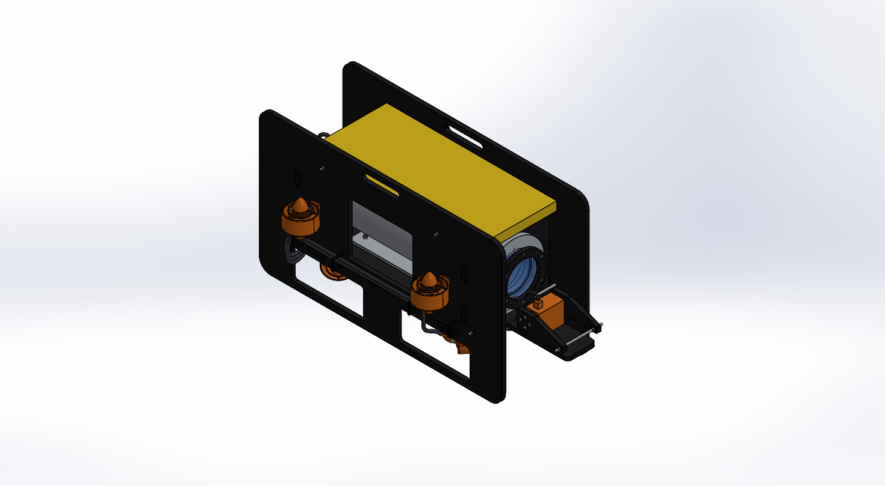
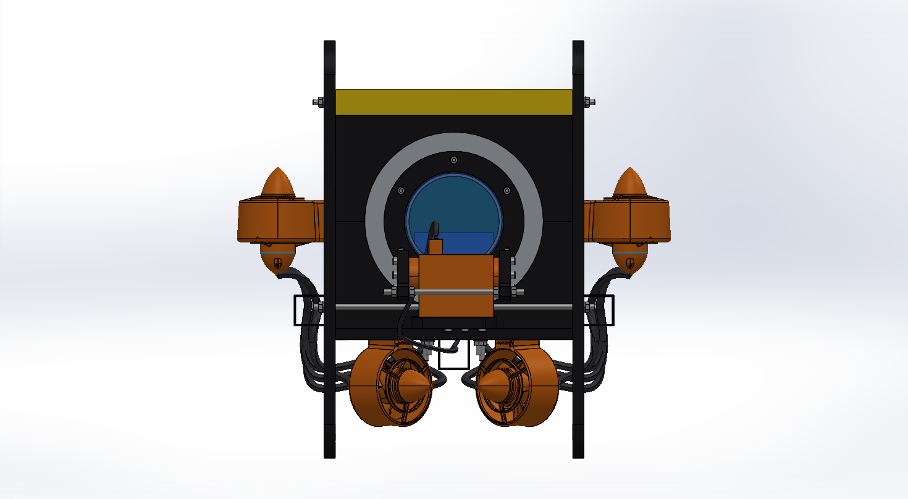
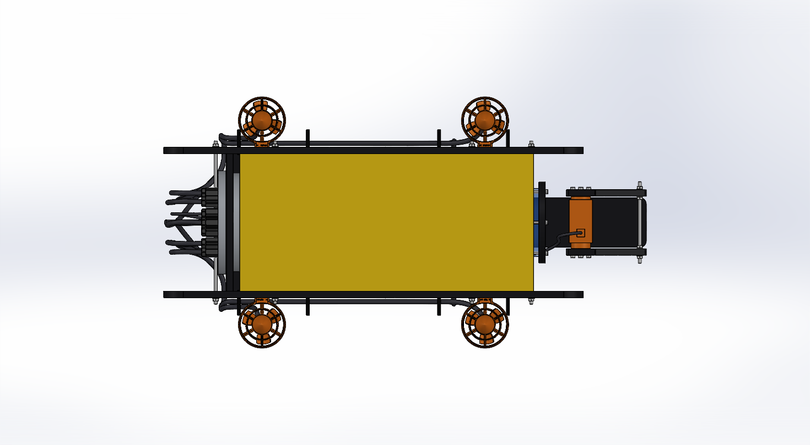
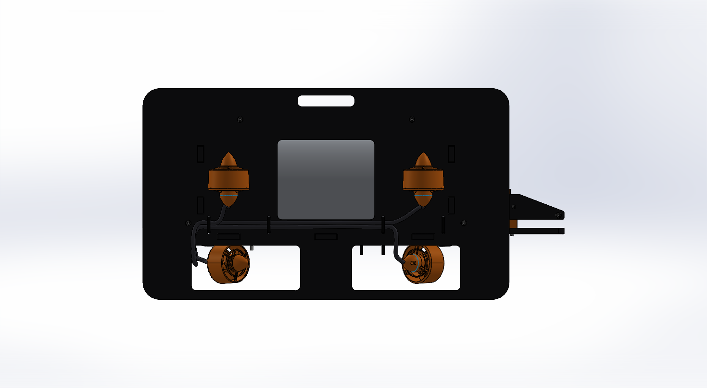

# ai_assisted_submarine

水中ドローンUWD-01の設計データ

AI が SOLIDWORKS を操作して設計した．3次元モデル，事前計算，部品表，正式文書を同じ設計値から生成する．



| 側面 | 上面 | 正面 |
| --- | --- | --- |
|  |  |  |

## 主要諸元

| 項目 | 値 |
| --- | --- |
| 設計水深 | 100 m |
| 与圧部 | 内径 140 mm，長さ 400 mm |
| 質量 | 16.6 kg |
| フレームの外形 | 長さ 640 mm，高さ 370 mm，幅 230 mm |
| スラスタ | ApisQueen U2 Mini 8台 |
| 制御 | 6自由度の独立制御 |
| 正味浮力 | 淡水で重量の +1.5 % |
| 把持機構 | 水中サーボ 1台，1自由度 |

設計の内容は詳細設計書 [UWD01-DDS-001](doc/09_提出/UWD01-DDS-001_A.pdf) に示す．

## フォルダ構成

```text
analysis/        設計値 rov_params.py，事前計算，計算結果 out/
cad/             生成した部品とアセンブリ
cad_source/      製造元の配布データ
doc/             文書と記録
  00_管理/         文書管理台帳，文書管理要領
  01_計画/         設計開発計画書
  02_要求/         要求仕様書
  03_設計/         詳細設計書，計算書，図
  04_審査/         設計審査記録
  05_検証/         設計検証記録
  06_妥当性確認/   妥当性確認の計画と記録
  07_変更/         設計変更記録
  08_購買/         部品表
  09_提出/         発行した提出物
quote/           見積と在庫の確認
src/uwd01/       3次元モデルの生成スクリプト
```

`doc/` の構成は ISO 9001:2015 の設計・開発の段階に対応する．対応と文書番号の規則は文書管理要領 [UWD01-MGT-001](doc/09_提出/UWD01-MGT-001_A.pdf) に示す．

## セットアップ

Windows と SOLIDWORKS 2024，Python 3.10 以上を使う．3次元モデルの生成には [swkit](https://github.com/waarrk/swkit) を使う．

```text
git clone https://github.com/waarrk/ai_assisted_submarine.git
git clone https://github.com/waarrk/swkit.git
cd ai_assisted_submarine
python -m venv .venv
.venv\Scripts\pip install -e ..\swkit[rapid,doc] numpy scipy
.venv\Scripts\swkit setup
```

## 生成

```text
.venv\Scripts\python src\uwd01\build.py                3次元モデル，質量，干渉，画像
.venv\Scripts\python analysis\buoyancy_balance.py      重量と浮力
.venv\Scripts\python analysis\controllability.py       制御力と可制御性
.venv\Scripts\python analysis\make_bom.py              部品表
.venv\Scripts\python -m swkit.docgen doc\03_設計\UWD01-DDS-001_詳細設計書.md    正式文書
```

設計値は `analysis/rov_params.py` の 1か所で管理する．`cad/` は生成物であり，手で直した内容は再生成で失われる．

## 文書

| 文書番号 | 名称 | 版 |
| --- | --- | --- |
| UWD01-MGT-001 | 文書管理要領 | A |
| UWD01-REQ-001 | 要求仕様書 | A |
| UWD01-DDS-001 | 詳細設計書 | A |

全文書の一覧と状態は [文書管理台帳](doc/00_管理/文書管理台帳.csv) で管理する．
