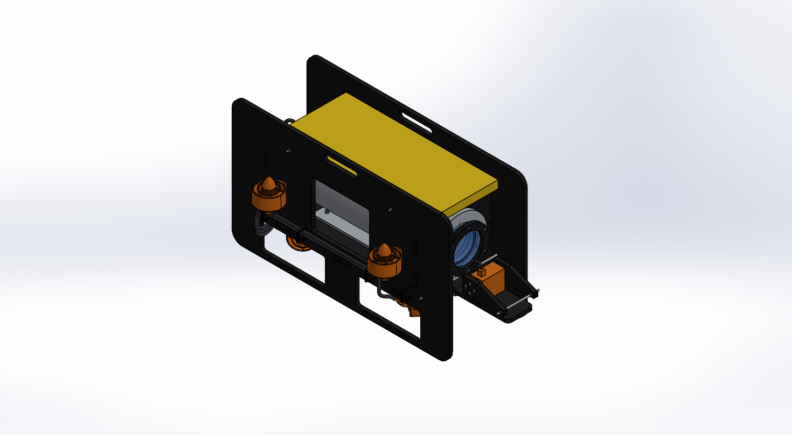

+++
number = "UWD01-DDS-001"
title = "水中ドローン UWD-01 詳細設計書"
version = "A"
date = "2026-11-25"
author = "鷲尾優作"
reviewer = ""
approver = ""
organization = ""
confidentiality = "公開"

[[revision]]
version = "A"
date = "2026-11-25"
content = "初版"
author = "鷲尾優作"

[[glossary]]
term = "与圧部"
meaning = "耐圧容器の内側で大気圧に保つ空間"
where = "5.1節"
[[glossary]]
term = "設計水深"
meaning = "強度と密閉を保証する最大の水深"
where = "3章"
[[glossary]]
term = "正味浮力"
meaning = "浮力から重量を引いた値"
where = "7.1節"
[[glossary]]
term = "BG"
meaning = "重心から浮心までの高さ"
where = "7.2節"
[[glossary]]
term = "復原モーメント"
meaning = "傾いた機体を元の姿勢へ戻すモーメント"
where = "式 (1)"
[[glossary]]
term = "制御行列"
meaning = "スラスタ 8台の推力を機体の力とモーメントへ変換する 6行 8列の行列"
where = "6.2節"
[[glossary]]
term = "つぶし率"
meaning = "Oリングの線径に対する圧縮量の割合"
where = "5.3節"
[[glossary]]
term = "共締め穴"
meaning = "相手部品と同じ位置に開ける締結用の穴"
where = "10章"
+++

# 適用範囲

水中ドローン UWD-01 の機械系の詳細設計を定める．対象は耐圧容器，フレーム，推進部，浮力調整部，マニピュレータ，内部機器の搭載構造，ハーネスの経路，締結部品である．電気回路，制御ソフトウェア，テザーは対象としない．

設計は要求事項 6件すべてに適合する．未確定事項 9件は 13章に示し，製作の前に確認する．

# 適用文書

表: 適用文書 {#tbl:applicable}

| 文書番号 | 名称 | 版 |
|---|---|---|
| UWD01-REQ-001 | 水中ドローン UWD-01 要求仕様書 | A |
| JIS B 2401-1 | Oリング 第1部 Oリング | 原本未照合 |
| JIS B 0405 | 普通公差 第1部 | 原本未照合 |
| JIS B 1001 | ボルト穴径及びざぐり径 | 原本未照合 |

JIS の 3件は規格値を原本で照合していない．照合は製図の前に実施する．

# 要求事項と適合

要求事項 6件に対する設計値を @tbl:req に示す．全件が適合する．

表: 要求事項と設計値 {#tbl:req}

| 番号 | 要求事項 | 設計値 | 根拠の箇所 |
|---|---|---|---|
| R-01 | 与圧部の内径 120 mm 以上，長さ 400 mm 以上 | 内径 140 mm，長さ 400 mm | 5.1節 |
| R-02 | 設計水深 100 m | 座屈の安全率 13.2 | 5.2節 |
| R-03 | 速度より姿勢制御を優先 | 6自由度の独立制御 | 6.2節 |
| R-04 | 物体の把持 | 1自由度の把持機構 | 8章 |
| R-05 | 市販の安価な水中スラスタの使用 | ApisQueen U2 Mini 8台 | 6.1節 |
| R-06 | 入手性のある市販部品の使用 | 購入品 26品目の在庫確認 | 11.2節 |

# 構成

機体は 8ユニットで構成する．外観を @fig:iso に，ユニットの質量を @tbl:units に示す．

{#fig:iso}

表: ユニットの構成と質量 {#tbl:units}

| ユニット | 主な構成品 | 質量 kg |
|---|---|---|
| 耐圧容器 | 耐圧筒，端蓋 2個，観察窓，ペネトレータ 10個 | 4.63 |
| フレーム | 側板 2枚，筒受け 2個，筒押え 2個，底板 | 4.71 |
| 推進部 | スラスタ 8台 | 1.68 |
| 浮力調整部 | 浮力材，バラスト 2枚 | 1.39 |
| マニピュレータ | サーボ，アーム板，可動爪 2個 | 0.65 |
| 締結部品 | ボルト，ナット，平座金，全ねじ | 0.36 |
| 内部機器 | 基板，バッテリ，内部トレイ | 2.79 |
| ハーネス | ケーブル，結束バンド | 0.25 |

全体の質量は 16.6 kg である．内部機器の質量には未作図の搭載物 1.3 kg の仮定値を含む．

座標は耐圧筒の中心を原点とし，前方を X，上方を Y，右舷を Z とする．寸法の単位は mm である．

# 耐圧容器

## 構造

耐圧容器は，アルミニウム合金の丸パイプに前後の端蓋をはめ込む構造とする．与圧部は内径 140 mm，長さ 400 mm である．差し込み基板 91.2 mm × 87 mm を収めるため，要求の内径 120 mm より大きい径を選定した．

表: 耐圧容器の構成品 {#tbl:hull}

| 構成品 | 材料 | 主要寸法 |
|---|---|---|
| 耐圧筒 | A6063-T5 丸パイプ | 外径 150 mm，肉厚 5 mm，全長 450 mm |
| 端蓋 | A6061-T6 丸棒 | つば外径 158 mm，受圧部の板厚 12 mm |
| 観察窓 | アクリル板 | 外径 104 mm，板厚 15 mm，開口径 80 mm |
| 窓押え環 | 高密度ポリエチレン板 | 外径 124 mm，板厚 10 mm |

前後の端蓋は旋削形状を共通とし，後端蓋にペネトレータ用の M10 めねじ 11か所，前端蓋に観察窓を設ける．端蓋は外部の水圧で筒へ押し付けられる．浅い水深での抜けは，フレーム下側の全ねじ 2本をつばの外側に通して止める．

## 強度

設計水深 100 m の外圧 1.005 MPa に対し，全構成品が安全率の下限を上回る．計算値を @tbl:strength に示す．

表: 設計水深での強度 {#tbl:strength}

| 構成品 | 評価項目 | 計算値 | 安全率 | 下限 |
|---|---|---|---|---|
| 耐圧筒 | 座屈圧力 | 13.2 MPa | 13.2 | 3.0 |
| 耐圧筒 | 降伏圧力 | 9.67 MPa | 9.6 | 2.0 |
| 端蓋 | 曲げ応力 | 91.6 MPa | 2.7 | 2.0 |
| 観察窓 | 曲げ応力 | 9.03 MPa | 7.7 | 4.0 |
| 浮力材 | 圧縮強さ 3.0 MPa | 外圧 1.005 MPa | 3.0 | 2.0 |

端蓋の曲げ応力は，周辺を単純支持した円板の式に穴の応力集中係数 2 を掛けた値である．観察窓と浮力材の下限 4.0 と 2.0 は設計者が定めた値で，材料メーカーの許容値とは照合していない．浮力材の圧縮強さは仮の値であり，13章の確認事項とする．

## 密閉

密閉部はすべて Oリングの固定用シールとする．つぶし率は 13 % から 27 % の範囲にある．

表: Oリングのつぶし率 {#tbl:oring}

| 箇所 | 呼び番号 | 本数 | つぶし率の公称 % | 最小 % | 最大 % |
|---|---|---|---|---|---|
| 端蓋のはめ込み部 | G-135 | 4 | 19.4 | 13.3 | 21.9 |
| 観察窓 | G-85 | 1 | 22.6 | 18.3 | 26.6 |

端蓋のはめ込み部は Oリングを 2段とし，1段目の損傷時にも 2段目で密閉を保つ．ケーブルの貫通には定格 1000 m の市販ペネトレータを使う．気密試験用に通気栓 1個を後端蓋に設ける．

# 推進と姿勢制御

## スラスタ

スラスタは ApisQueen U2 Mini を 8台使う．1台の推力は正転で 12.7 N とした．逆転の推力 11.8 N は仮の比率から求めた値で，実測で確認する．耐水深は公表されておらず，13章の確認事項とする．

表: スラスタの配置 {#tbl:thr}

| 群 | 台数 | 位置 mm | 推力の向き | 取付先 |
|---|---|---|---|---|
| 垂直 | 4 | X ±170，Y 0，Z ±156 | 上向き | 側板の外面 |
| 水平 | 4 | X ±170，Y −146，Z ±56 | 水平面内で前後軸から 45° | 底板の下面 |

## 制御力

スラスタ 8台で，並進 3方向と回転 3方向を独立に制御できる．制御行列の階数は 6 で，冗長な台数は 2台である．各軸の最大値を @tbl:authority に示す．値は他の 5成分を 0 に保つ条件で求めた上限である．

表: 各軸の制御力の最大値 {#tbl:authority}

| 軸 | 正常時 | 1台停止時の最小 |
|---|---|---|
| 前後の力 | 33.3 N | 16.6 N |
| 上下の力 | 44.2 N | 22.1 N |
| 左右の力 | 33.1 N | 15.9 N |
| ロールのモーメント | 7.34 N·m | 3.67 N·m |
| ヨーのモーメント | 7.52 N·m | 3.76 N·m |
| ピッチのモーメント | 8.00 N·m | 4.00 N·m |

1台が停止しても，停止する 8通りのすべてで 6自由度の制御を保つ．2台が停止する 28通りでは，16通りで 6自由度を保ち，12通りで 1自由度を失う．

## 姿勢の保持

正常時は任意の姿勢を保持できる．傾き角 θ での復原モーメントは @eq:restore で表す．

$$ M = W g \, \overline{BG} \, \mathrm{sin} \theta $$ {#eq:restore}

W は機体の質量 16.6 kg，g は重力加速度，BG は 24.3 mm である．復原モーメントの最大値は 3.97 N·m となり，ロールとピッチの制御モーメントはその 1.8倍と 2.0倍である．垂直スラスタ 1台の停止時はロールのモーメントが 3.67 N·m に下がり，保持できる傾きは 68° までとなる．

# 重量と浮力の収支

## 正味浮力

淡水での正味浮力は +0.25 kgf で，重量の 1.5 % である．スラスタの停止時に機体は緩やかに浮上する．海水では +0.67 kgf となり，重量の 4.0 % である．

表: 浮力と重量 {#tbl:buoy}

| 条件 | 質量 kg | 浮力 kgf | 正味浮力 kgf |
|---|---|---|---|
| 淡水 | 16.61 | 16.86 | +0.25 |
| 海水 | 16.61 | 17.28 | +0.67 |

浮力材の厚さ 23 mm は，淡水で正味浮力が重量の 1.5 % となる値として定めた．浮力材の厚さ 1 mm は浮力 75 gf に相当する．海水で使う場合はバラストを片舷 1枚追加して調整する．

## 重心と浮心

重心は浮心の 24.3 mm 下にあり，機体は自ら水平へ戻る．重心は浮心より 0.6 mm 前方にあり，静止時の姿勢は機首下げ 1.5° である．前後の釣合いは浮力材の前後位置で調整した．

# マニピュレータ

機首に 1自由度の把持機構を設ける．水中サーボの出力円板と従動軸に可動爪 2個を取り付け，アーム板の先端との間で物体を挟む．可動爪 2個は全ねじ 1本で連結する．

表: 水中サーボの仕様 {#tbl:servo}

| 項目 | 値 |
|---|---|
| 型式 | ROVMaker RM-SV-40 |
| 使用水深 | 300 m |
| トルク | 定格 1.5 N·m，最大 3.0 N·m |
| 定格電圧 | 12 V |
| 質量 | 360 g |
| ケーブル | 外径 4 mm，長さ 0.7 m |

爪の先端の押付け力は，回転中心から連結用の全ねじまでの距離 90 mm で定格トルクを割った 17 N である．サーボの寸法は販売元の寸法図に基づく値で，現物では確認していない．

サーボの採用に伴う設計上の対処は 3件である．定格電圧 12 V に合わせ，耐圧容器内に直流変換器を追加する．ケーブル長 0.7 m は後端蓋に届かないため，延長して接続部を樹脂で封止する．サーボ本体の上面は耐圧筒の中心から 29.5 mm 下にあり，観察窓の視野の下側に入る．

# 内部機器とハーネス

## 内部機器

内部機器は板金の内部トレイに載せ，後端蓋の支柱 2本に固定する．後端蓋を引き抜くと内部機器が一体で取り出せる．基板は BIRDS 衛星バスの構成を流用し，バックプレーン基板 1枚に差し込み基板 6枚を立てる．

## ハーネス

スラスタ 8台とサーボのケーブルは側板と底板に結束バンドで固定し，後端蓋のペネトレータへ導く．固定箇所は側板に片舷 4か所，底板に 2か所である．経路は 3次元の形状として作図し，他の部品との干渉がないことを確認した．

# 締結部品

締結部品は全数をミスミの型番で指定し，販売元の形状データを配置して干渉を確認した．相手部品と共通の位置にある穴は，組立状態で 1つの穴として定義し，各部品へ反映している．

表: 締結部品 {#tbl:fastener}

| 型番 | 品名 | 数量 | 用途 |
|---|---|---|---|
| SCB3-16 | 六角穴付ボルト M3×16 | 32 | スラスタの取付 |
| SCB3-14 | 六角穴付ボルト M3×14 | 6 | サーボの取付 |
| SCB4-14 | 六角穴付ボルト M4×14 | 8 | 可動爪の取付 |
| SCB4-30 | 六角穴付ボルト M4×30 | 6 | 窓押え環の取付 |
| SCB5-35 | 六角穴付ボルト M5×35 | 8 | アーム板とバラストの取付 |
| SCB4-8 | 六角穴付ボルト M4×8 | 2 | 内部トレイの取付 |
| SLBNR5 | 六角ナット M5 | 20 | 全ねじとボルトの締結 |
| SPWF5 | 平座金 M5 | 24 | 樹脂板の座面 |
| FABS5-250 | 全ねじ M5×250 | 4 | フレームの締結 |
| FABS5-125 | 全ねじ M5×125 | 1 | 可動爪の連結 |
| VSLSBG8-40.0-M4-N4 | 六角支柱 M4×40 | 2 | 内部トレイの支持 |

材質はすべてステンレス鋼である．M3 と M4 のボルトの頭の下には平座金を入れていない．サーボのめねじ深さ 5 mm に対してねじ込み長さ 4 mm を確保するためである．樹脂板の座面のへたりは試作で確認する．

# 製作と手配

## 加工方法

加工品は 13種である．旋盤加工は耐圧筒と端蓋 2個の 3点に限り，他は板からの輪郭切断と板金 1点とした．

表: 加工品の加工方法 {#tbl:process}

| 部品 | 数量 | 素材 | 加工方法 |
|---|---|---|---|
| 耐圧筒 | 1 | A6063-T5 丸パイプ | 切断，両端の内径仕上げ |
| 端蓋 | 2 | A6061-T6 丸棒 | 旋削 2工程，ねじ加工 |
| 観察窓 | 1 | アクリル板 15 mm | 円形の切り出し |
| 板部品 11枚 | 11 | 高密度ポリエチレン板 10 mm | ウォータージェット切断 |
| 浮力材 | 1 | 独立気泡フォーム板 23 mm | 切り出し，樹脂封止 |
| バラスト | 2 | SUS304 フラットバー | 切断，穴あけ |
| 内部トレイ | 1 | A5052 板 2 mm | 板金，曲げ 1か所 |

板部品 11枚は，側板 2枚，筒受け 2個，筒押え 2個，底板，アーム板，可動爪 2個，窓押え環である．素材と板厚を 1種に揃え，切断の段取りを 1回にまとめた．

## 購入品

購入品 26品目は販売元の在庫表示を 2026年 11月 25日に確認した．スラスタ，ペネトレータ，サーボ，締結部品は在庫がある．差し込み基板用のコネクタは入手先が見つかっておらず，代替品を選定する．

# 検証結果

3次元モデルで拘束と干渉を確認した．全ユニットで未拘束の構成品はない．干渉 414件はすべて意図した重なりである．

表: 干渉の内訳 {#tbl:interference}

| 組合せ | 件数 | 内容 |
|---|---|---|
| バックプレーン基板とコネクタ | 300 | 端子の基板への挿入 |
| 後端蓋とペネトレータ | 33 | ねじ部のはめ合い |
| スラスタとボルト | 32 | ねじ部のはめ合い |
| ナットと全ねじまたはボルト | 20 | ねじ部のはめ合い |
| サーボとボルト | 14 | ねじ部のはめ合い |
| 前端蓋とボルト | 6 | ねじ部のはめ合い |
| 耐圧筒または観察窓と Oリング | 5 | つぶし代 |
| 六角支柱とボルトまたは後端蓋 | 4 | ねじ部のはめ合い |

実機での検証は未実施である．気密試験，耐圧試験，推力の実測を妥当性確認として計画する．

# 未確定事項と制約

製作の前に確認する事項を @tbl:open に示す．

表: 未確定事項 {#tbl:open}

| 番号 | 事項 | 確認の方法 |
|---|---|---|
| O-01 | スラスタの耐水深 | 製造元への照会 |
| O-02 | スラスタの逆転推力 | 実測 |
| O-03 | 浮力材の圧縮強さと密度 | 材料の仕様書 |
| O-04 | サーボの取付寸法 | 現物の測定 |
| O-05 | サーボ用の直流変換器とケーブル延長 | 品番の選定 |
| O-06 | 差し込み基板用コネクタの入手先 | 代替品の選定 |
| O-07 | 観察窓の視野へのサーボの写り込み | カメラ位置と画角の決定 |
| O-08 | JIS の規格値 | 原本との照合 |
| O-09 | 樹脂板の座面のへたり | 試作での確認 |

強度は手計算による評価であり，有限要素法による解析は実施していない．流体抵抗と最高速度は評価していない．費用は別紙の部品表と見積記録に示す．
